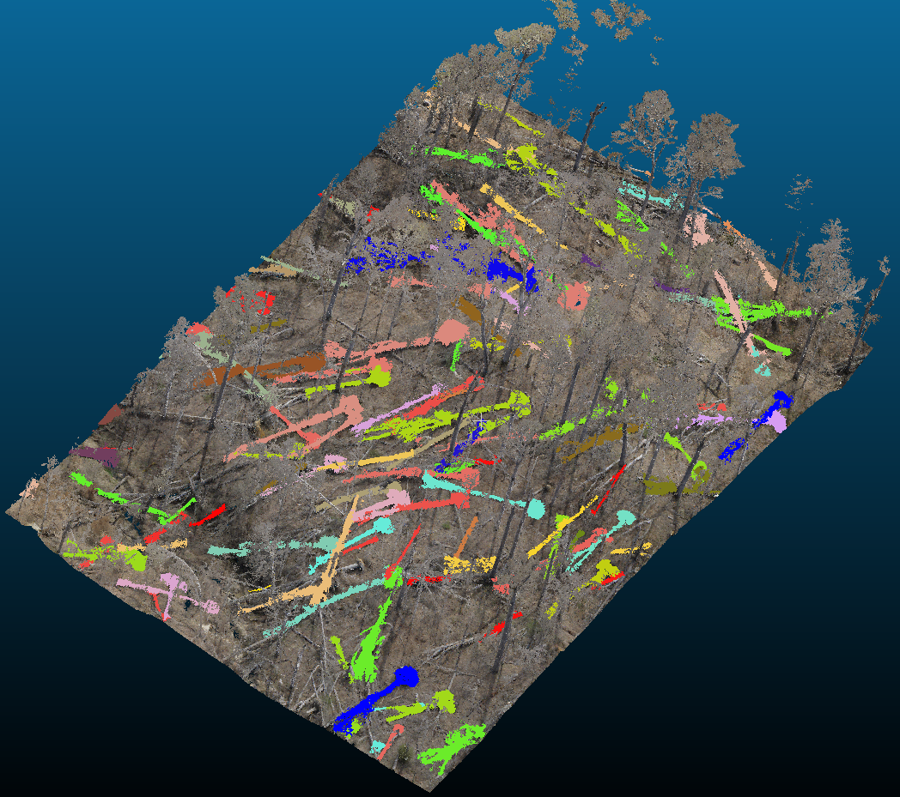

# FallenTreeDetection3D

Fallen tree detection from 3D point clouds over tornado-affected regions. The model
takes an aerial LiDAR point cloud and segments it into tree parts, separating standing
trees from fallen trees so that individual downed stems can be extracted.

Built on a PointNet++ part-segmentation backbone (`models/pointnet2_part_seg_*`).

## Setup

```shell
conda create -n fallentree python=3.9
conda activate fallentree
pip install torch numpy tqdm
```

A CUDA GPU is required.

## Training

```shell
python train_treepartseg.py \
    --model=pointnet2_part_seg_msg_4k \
    --npoint=4000 \
    --batch_size=8 \
    --epoch=100 \
    --rgbi_channel \
    --tag=my_run
```

Checkpoints and logs are written to `log/part_seg/<timestamp>_<tag>/`.

## Testing

```shell
python test_treepartseg.py \
    --model=pointnet2_part_seg_msg_4k \
    --log_dir=<trained_run_folder> \
    --base_dir=<repo_root> \
    --num_point=4000 \
    --batch_size=1 \
    --rgbi_channel
```

`--log_dir` is the run folder created during training. Example invocations for both
training and testing are collected in `scripts/`.

## Repository layout

| Path | Description |
|--|--|
| `train_treepartseg.py` | Training entry point |
| `test_treepartseg.py` | Testing / inference entry point |
| `models/` | PointNet / PointNet++ architectures and loss functions |
| `data_utils/` | Data loaders and preprocessing utilities |
| `scripts/` | Shell scripts with example training and testing runs |
| `visualizer/` | Point cloud visualization tools |

## Detection Results

<!-- Add result image here -->


## Acknowledgement

The PointNet / PointNet++ implementation is based on
[yanx27/Pointnet_Pointnet2_pytorch](https://github.com/yanx27/Pointnet_Pointnet2_pytorch).
